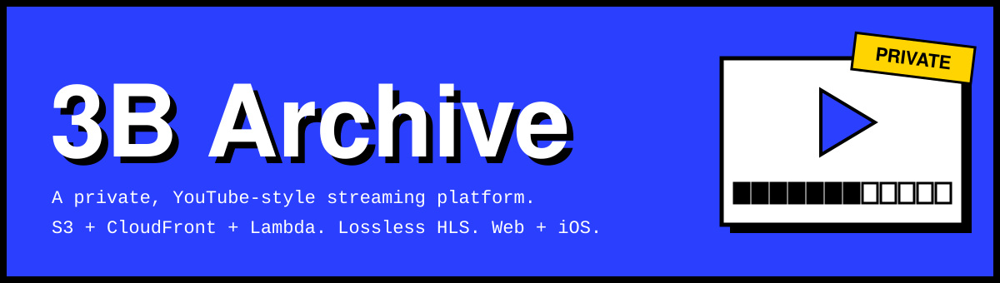
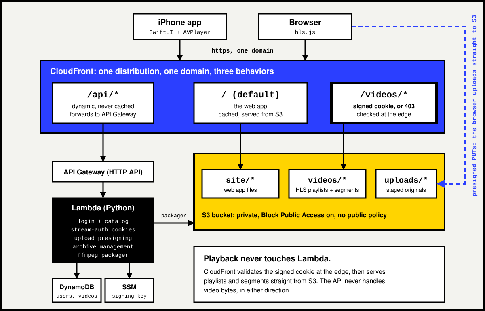
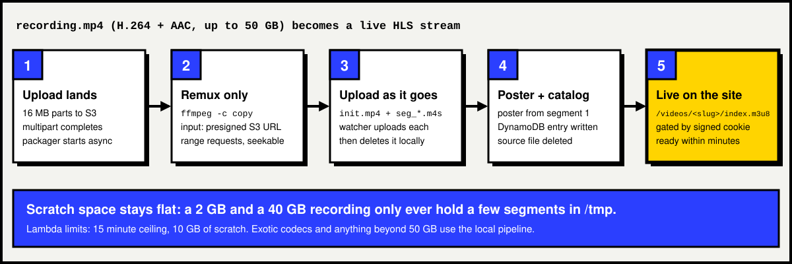

<p align="center">
  
</p>

<p align="center">
  <a href="https://github.com/iamirtasam/3b-archive/actions/workflows/ci.yml"></a>
  <a href="LICENSE"></a>
  
  
  
  
</p>

<p align="center">
  <b>Your whole video library, streamed to a website and an iPhone, from a fully private S3 bucket, for about $8 a month.</b>
</p>

<p align="center">
  <a href="#features">Features</a> |
  <a href="#architecture">Architecture</a> |
  <a href="#video-pipeline">Video pipeline</a> |
  <a href="#getting-started">Getting started</a> |
  <a href="#cost">Cost</a> |
  <a href="#security-model">Security</a> |
  <a href="#faq">FAQ</a>
</p>


## Why this exists

I ran out of disk space. About 320 GB of screen recordings and nowhere to put them. YouTube unlisted is a terms-of-service gray zone with ads and no control. A NAS is a machine I have to keep running. A paid streaming service is a subscription for content nobody else should see.

So I built the thing I actually wanted: recordings live in a private S3 bucket, stream instantly to a website and an iPhone, and cost about the price of a coffee per month. Uploading is drag-and-drop from the browser, the cloud packages everything automatically, and my PC can stay off for a month without anything breaking.

The code was written with AI assistance. The AWS architecture is my own design, and every choice in it (trusted key groups over Lambda@Edge, signed cookies over signed URLs, remuxing over transcoding, one distribution over many origins) is documented below with the alternative I rejected and why.

| ~$8 | 0 | 50 GB | 0 |
|:---:|:---:|:---:|:---:|
| per month for 320 GB | servers to keep running | per-file upload limit | pixels re-encoded |


## Features

<table>
  <tr>
    <td width="33%" valign="top">
      <br>
      <b>Stream everywhere</b><br>
      A brutalist-editorial web app (hls.js) and a native iOS app (SwiftUI + AVPlayer), built from Windows with no Mac.
    </td>
    <td width="33%" valign="top">
      <br>
      <b>Upload like a studio</b><br>
      Drop a file or a whole folder on the web uploader. 16 MB chunks go straight to S3, resume across reboots, and handle up to 50 GB per file.
    </td>
    <td width="33%" valign="top">
      <br>
      <b>Zero-touch publishing</b><br>
      When an upload lands, a background Lambda runs ffmpeg in the cloud: lossless HLS remux, poster frame and catalog entry. Live in minutes.
    </td>
  </tr>
  <tr>
    <td width="33%" valign="top">
      <br>
      <b>Actually private</b><br>
      CloudFront trusted-key-group signed cookies. The bucket blocks all public access, and anonymous requests get a 403 before they reach S3.
    </td>
    <td width="33%" valign="top">
      <br>
      <b>Archive management</b><br>
      Rename, re-folder and hard-delete videos and folders from the site or the phone. Deleting walks S3 and removes every segment.
    </td>
    <td width="33%" valign="top">
      <br>
      <b>Resume playback</b><br>
      Pick up a video where you left off on the device you started it on.
    </td>
  </tr>
</table>


## Architecture

One CloudFront distribution is the entire front door. The site, the API and the videos share a single domain, which is what keeps the privacy model and the playback path simple.

<p align="center">
  
</p>

### Request lifecycle

1. **Login.** `POST /api/login` makes Lambda check a salted PBKDF2 hash (200k iterations) against DynamoDB and set an `svg_session` cookie. It then mints CloudFront signed cookies through `/api/stream-auth`, using a private key read at runtime from SSM Parameter Store.
2. **Browse.** `GET /api/videos` scans the `svg_videos` table, and the SPA renders folder chips and video cards.
3. **Play.** The browser requests `/videos/<slug>/index.m3u8`. CloudFront validates the signed cookie at the edge, so Lambda is not in the playback path at all. hls.js pulls segments on demand, so only the seconds you watch cross the network.
4. **Upload.** The browser asks Lambda to create a multipart upload and receives presigned part URLs. 16 MB chunks are PUT directly to S3, so the API never touches video bytes.
5. **Auto-publish.** Completing the upload triggers an async self-invocation of the same Lambda, which streams the original from S3 through a vendored static ffmpeg and writes the catalog entry.

### Design decisions

| Decision | Why | Rejected alternative |
|---|---|---|
| **Trusted key groups** for `/videos/*` | Signature validation happens at the edge in every PoP, with no compute cost | Lambda@Edge or CloudFront Functions: another moving part, extra cost, cold starts in the hot path |
| **Signed cookies, not signed URLs** | One signature covers the whole session, and every playlist and segment request carries it automatically | Signed URLs: roughly 500 per video, one per segment, each needing a refresh mid-playback |
| **One distribution, three behaviors** | Site, API and video share a domain, so cookies just work with no CORS preflights, one DNS name and one certificate | A separate API domain: CORS overhead, SameSite cookie headaches, a second cache to tune |
| **S3 multipart as upload state** | `ListMultipartUploads` is the staged-files database, so resume survives a refresh for free | A DynamoDB upload table: one more thing to keep consistent with reality |
| **fMP4 HLS segments** (`init.mp4` + `seg_*.m4s`) | Fixes a real bug where MPEG-TS segments muddy AAC audio after the first boundary in hls.js, and modern iOS prefers fMP4 | MPEG-TS, the legacy default |
| **Presigned URL as ffmpeg input** | ffmpeg's HTTP backend issues range requests, so files with a trailing `moov` atom seek correctly. A stdin pipe cannot seek and fails exactly there | Downloading the whole file to `/tmp`, which has a 10 GB ceiling |
| **Segments uploaded while ffmpeg runs** | A watcher uploads each finished segment and deletes it, so a 40 GB source only occupies a few segments of scratch space | Batch upload after the remux, which hits the 10 GB `/tmp` ceiling |
| **Remux, never transcode** | `-c copy` is bit-for-bit identical to the source, runs at disk speed and costs nothing. MediaConvert quoted $180 to $800 for this library | AWS Elemental MediaConvert: re-encodes everything, doubles storage, costs real money |


## Video pipeline

<p align="center">
  
</p>

`-c copy` never re-encodes a pixel. A 6 GB recording packages in a few minutes inside Lambda's free tier, and the output is visually identical to the source.

## Tech stack

| Layer | Tools |
|---|---|
| Edge | CloudFront with Origin Access Control, trusted key groups, signed cookies |
| Compute | AWS Lambda (Python), API Gateway HTTP API |
| Storage | S3 (private, multipart uploads), DynamoDB, SSM Parameter Store |
| Media | ffmpeg (static build vendored into Lambda), HLS with fMP4 segments |
| Web | Single-page app in HTML, CSS and JavaScript, with hls.js vendored (no CDN) |
| iOS | SwiftUI, AVPlayer, xtool for building and signing without a Mac |
| Tooling | Python deploy scripts, GitHub Actions CI |


## Repo map

```
├── site/                  The web app, served by CloudFront
│   ├── index.html         SPA shell: login, archive, player, uploader
│   ├── app.js             Routing, HLS playback, resume, uploads, management
│   ├── styles.css         Brutalist editorial design system
│   └── hls.min.js         Vendored hls.js
├── backend/
│   ├── app/handler.py     The whole API: auth, catalog, upload presigning,
│   │                      archive management and the ffmpeg packager
│   ├── deploy.py          Idempotent provisioning: tables, SSM, Lambda, HTTP API, IAM
│   ├── sync_cloudfront.py Distribution wiring: 3 origins, 3 behaviors
│   ├── deploy_site.py     Site upload and CDN invalidation
│   ├── ensure_cors.py     Bucket CORS for browser PUTs
│   ├── fetch_ffmpeg.py    Downloads the static ffmpeg vendored into Lambda
│   ├── create_user.py     Create a viewer account (salted PBKDF2)
│   ├── list_users.py      List or remove accounts
│   ├── seed_catalog.py    Sync the local catalog to DynamoDB
│   ├── test_manage.py     End-to-end test of the archive management API
│   └── e2e_test.py        Whole-stack verification
├── ios/                   Native iOS app: SwiftUI + AVPlayer
│   ├── Sources/           Login, archive grid, cookie-authed player
│   ├── deploy.sh          One command to build, sign and install (WSL to iPhone)
│   ├── setup-wsl-toolchain.sh   Swift toolchain and xtool installer
│   └── check-device.sh    iPhone bridge diagnostics
├── scripts/               Local pipeline for >50 GB files or offline work
│   ├── pipeline.py        Remux and upload in one resumable command
│   ├── publish.py         Manual publisher, slug-compatible with the cloud
│   ├── sign-url.py        Manual signed-URL generator (for VLC and friends)
│   └── lib/               ffmpeg, S3, catalog and thumbnail helpers
├── site-design/           Design system: tokens, type scale, motion spec
├── docs/aws-setup.md      One-time AWS setup walkthrough
└── config.example.json    Copy to config.json and fill in your values
```

## Getting started

### Prerequisites

- AWS CLI, with `aws configure` done and credentials that can create resources
- Python 3.12 or newer, then `pip install -r scripts/requirements.txt`
- ffmpeg on your PATH (`winget install Gyan.FFmpeg` on Windows)

### 1. One-time AWS setup (about 30 minutes, $0)

Follow [docs/aws-setup.md](docs/aws-setup.md): private S3 bucket, CloudFront key pair and trusted key group, a distribution with Origin Access Control, and a zero-spend billing alarm. Every step has both a Console path and a CLI path.

### 2. Configure and deploy

```bash
copy config.example.json config.json   # bucket name, region, CloudFront key info
python backend\deploy.py               # DynamoDB, SSM, Lambda, HTTP API, IAM
python backend\sync_cloudfront.py      # wire the three behaviors
python backend\ensure_cors.py          # browser PUT permissions
python backend\deploy_site.py          # ship the website
python backend\create_user.py <username> <password>
```

### 3. Use it

- **Website.** Open the distribution domain, log in and drag videos onto the uploader. They publish themselves.
- **iPhone.** Run `bash ios/deploy.sh` from WSL with the phone plugged in. The one-time toolchain setup is [ios/setup-wsl-toolchain.sh](ios/setup-wsl-toolchain.sh), which needs an Xcode.xip download and an Apple ID.
- **Huge batches.** Run `python scripts/pipeline.py --source "D:\Recordings\Batch"` from the PC. It is resumable.

### Operations cheatsheet

| Task | Command |
|---|---|
| Create a viewer | `python backend\create_user.py <user> <pass>` |
| List or delete viewers | `python backend\list_users.py` / `--delete <user>` |
| Update backend code | `python backend\deploy.py` |
| Update the website | `python backend\deploy_site.py` |
| Verify the whole stack | `python backend\e2e_test.py` |
| Test archive management | `python backend\test_manage.py` |
| Watch packager logs | `aws logs tail /aws/lambda/s3-streaming-api` |
| Manual signed URL (VLC) | `python scripts\sign-url.py <slug>` |


## Cost

| Item | Monthly | Notes |
|---|---|---|
| S3 Standard (320 GB, ap-south-1) | ~$8 | The only real cost |
| CloudFront egress | $0 | First 1 TB per month is free |
| Lambda + API Gateway | ~$0 | Well inside the free tier (packager is about 300 GB-s per video) |
| DynamoDB | $0 | On-demand, a few hundred reads per day |
| SSM Parameter Store | $0 | One SecureString |
| **Total** | **about $8** | Less than a month of any streaming service |

## Security model

- **S3.** All four Block Public Access settings are on, with no public bucket policy entries. Direct S3 URLs return 403.
- **Playback.** `/videos/*` requires CloudFront signed cookies minted by Lambda after authentication. Validation happens at the edge through a trusted key group. The signing key lives in SSM Parameter Store, is fetched at runtime and never sits in the repo.
- **Auth.** PBKDF2-SHA256 with 200,000 iterations and a per-user random salt. Sessions are opaque 256-bit tokens, stored hashed with a TTL in DynamoDB. Login responses are timing-equalized against unknown usernames.
- **Uploads.** Presigned part URLs are scoped to `uploads/<username>/...`, so one user cannot write into another's prefix. Aborting a multipart upload needs the same ownership check.
- **Management APIs.** Every delete, rename and move validates the session and the key path on the server.

## FAQ

<details>
<summary><b>Why not YouTube unlisted?</b></summary>
<br>
Terms-of-service risk, ads, no API for a private client, and your content feeds their recommendations. Building it is also the fun part.
</details>

<details>
<summary><b>Why not Plex or Jellyfin?</b></summary>
<br>
They are great, but they want a machine running around the clock. This architecture has zero servers: turn the PC off for a month and playback still works.
</details>

<details>
<summary><b>Why HLS instead of progressive MP4?</b></summary>
<br>
Instant seeking, chunked delivery (only watched seconds travel), native iOS support, and the same delivery model YouTube uses. `faststart` MP4s work but seek noticeably slower on real connections.
</details>

<details>
<summary><b>How is the iOS app built without a Mac?</b></summary>
<br>
<a href="https://xtool.sh">xtool</a> compiles Swift with a Linux toolchain and signs with Apple's own services, with no Mac and no paid developer account. The interesting part was the WSL to iPhone USB bridge: usbipd corrupts large USB transfers, and the fix is a TCP forward of Windows' Apple socket. See <code>ios/check-device.sh</code>.
</details>

<details>
<summary><b>What happens to a 40 GB upload?</b></summary>
<br>
The same as a 2 GB one. Chunks stream to S3, and the packager streams segments out as ffmpeg produces them, so scratch space stays flat regardless of source size. The only hard limit is Lambda's 15-minute ceiling.
</details>

## Known limitations

- One video quality (the source's). There is no adaptive bitrate ladder yet.
- Playback position resumes per device and is not synced across devices.
- Free Apple developer accounts require re-signing the iOS app every 7 days (`bash ios/deploy.sh`).
- The cloud packager handles H.264/AAC remuxes only. Exotic codecs fall back to the local pipeline.

## Roadmap

- [x] **Phase 1.** AWS setup and local remux/upload pipeline
- [x] **Phase 2.** First videos migrated (Valorant batch, 3.7 GB, 327 segments)
- [x] **Phase 3.** Backend: login, folder catalog, signed cookie issuing
- [x] **Phase 4.** Website: login, folder browse, gallery, HLS player with resume
- [x] **Phase 5.** Web uploader and zero-touch cloud packaging
- [x] **Phase 6.** iOS app via xtool (SwiftUI + AVPlayer, built from Windows)
- [x] **Archive management.** Delete, rename and re-folder on site and iOS
- [x] **Folder uploads.** Pick a whole folder, up to 50 GB per file
- [ ] Cross-device progress sync
- [ ] Adaptive bitrate ladder (MediaConvert per upload, if needed)
- [ ] Re-sign reminder for the iOS app

## License

Released under the [MIT License](LICENSE).


<p align="center">
  Built by <a href="https://github.com/iamirtasam">iamirtasam</a>
</p>
